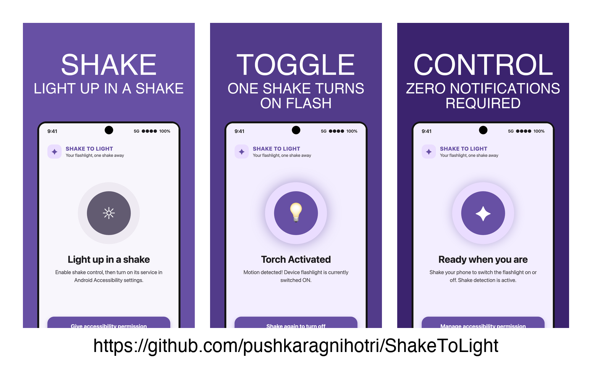
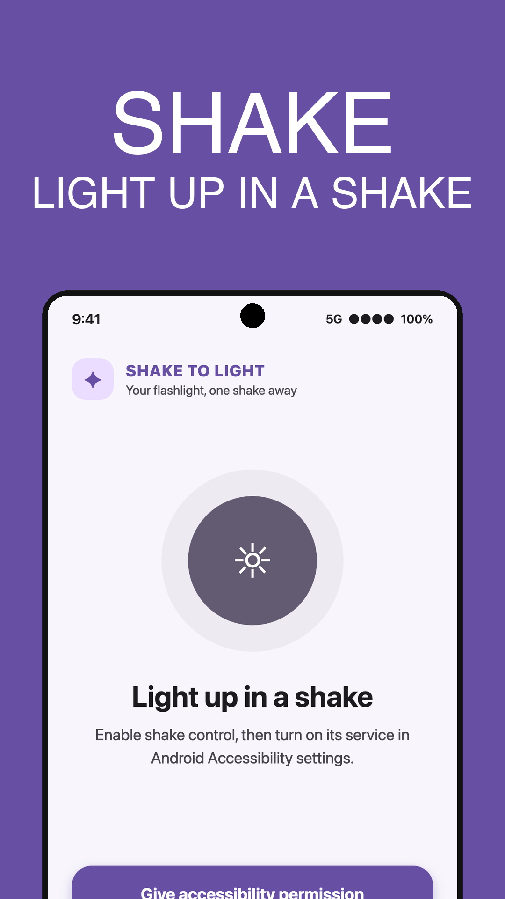
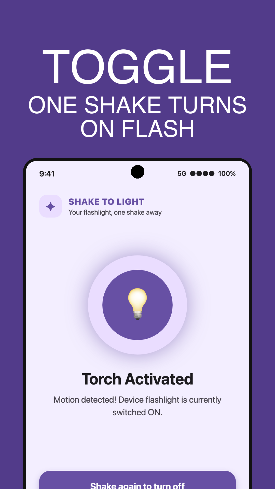
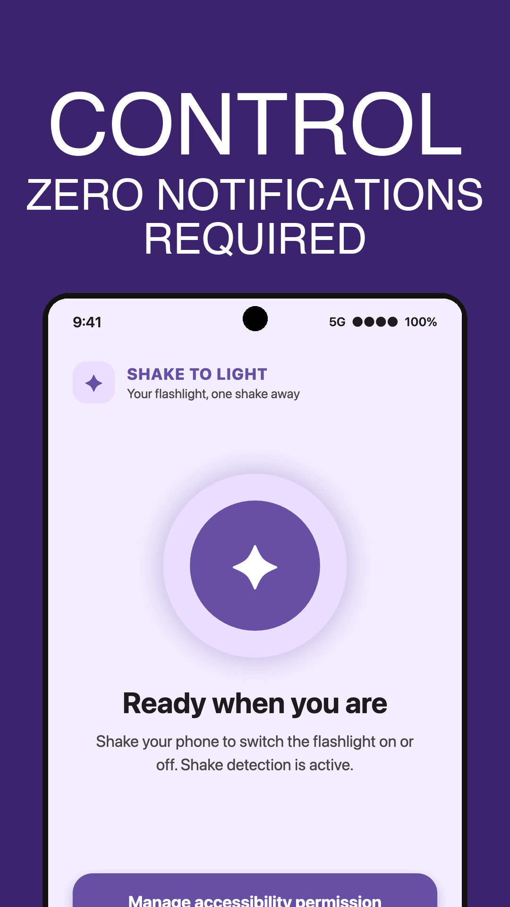

# ShakeToLight


**ShakeToLight** – an Android app that lets you toggle the device flashlight with a quick shake of the phone.

## Table of Contents
- [Features](#features)
- [Screenshots](#screenshots)
- [Branches & Background Execution](#branches--background-execution)
- [Installation](#installation)
- [Build & Run Locally](#build--run-locally)
- [Usage](#usage)
- [Permissions](#permissions)
- [Contributing](#contributing)
- [License](#license)

## Features
- **Shake detection** – uses the accelerometer to detect a brisk shake.
- **Camera flash control** – toggles the flashlight on/off instantly.
- **Adaptive icon** – modern squircle icon that works on all Android launchers.
- **No foreground notification** – implements the feature through an `AccessibilityService` for a clean UI experience.

## Screenshots



<p align="center">
  
  
  
</p>

## Branches & Background Execution

The repository contains two approaches for background execution:

- **`main` (Play) flavor** – the original implementation uses a foreground `Service` (`ShakeTorchService`) with an ongoing notification to keep the shake detection active while the app is in the background. This complies with Google Play policies for background work but shows a persistent notification.
- **`sideload` (Accessibility) flavor** – introduced to **bypass the foreground‑service requirement**. It replaces the foreground service with an `AccessibilityService` (`ShakeAccessibilityService`) that runs in the background without a visible notification. The service only listens to accelerometer events and does **not** read accessibility events or window content, making it suitable for sideloaded testing or non‑Play‑store distribution.

### What Changed to Bypass the Foreground Service

| Change | Description |
|--------|-------------|
| **Removed** `ShakeTorchService` and its foreground‑service declaration from the manifest. | Eliminates persistent foreground notification. |
| **Added** `ShakeAccessibilityService` with `BIND_ACCESSIBILITY_SERVICE` permission. | Enables background accelerometer sensing via accessibility API. |
| **Consolidated** flavors into single `main` module. | Clean, unified build target without redundant flavor suffixes. |
| **Updated** `MainActivity` & permissions flow. | Guides user directly to enable accessibility service. |

The accessibility‑service method is now merged into the default `main` branch, building a single APK that uses this clean background approach by default.

## Installation
You can install the latest release from the **GitHub Releases** page:

1. Download `app-debug.apk` (or `app-release.apk` if you have a signed version).
2. Transfer the APK to your device.
3. Open the file and tap **Install** (enable *Install unknown apps* for the source if needed).

## Build & Run Locally
```bash
# Clone the repository
git clone https://github.com/pushkaragnihotri/ShakeToLight.git
cd ShakeToLight

# Build the debug APK
./gradlew assembleDebug

# Install on a connected device (ADB required)
adb install -r app/build/outputs/apk/debug/app-debug.apk
```

## Usage
1. Launch **ShakeToLight**.
2. Grant **Camera** permission when prompted.
3. Open **Settings → Accessibility** and enable **Shake detection**.
4. Shake your phone briskly – the flashlight will toggle on/off.

## Permissions
- `android.permission.CAMERA` – required to control the flashlight.
- `android.permission.BIND_ACCESSIBILITY_SERVICE` – required for the background shake detection service.

The app does **not** read any other accessibility events or screen content.

## Contributing
Contributions are welcome! Feel free to:
- Open an issue for bugs or feature requests.
- Submit a pull request with improvements or new features.
- Add tests or documentation updates.

Please follow the existing code style and run `./gradlew lint` before submitting.

## License
This project is licensed under the **MIT License** – see the [LICENSE](LICENSE) file for details.
